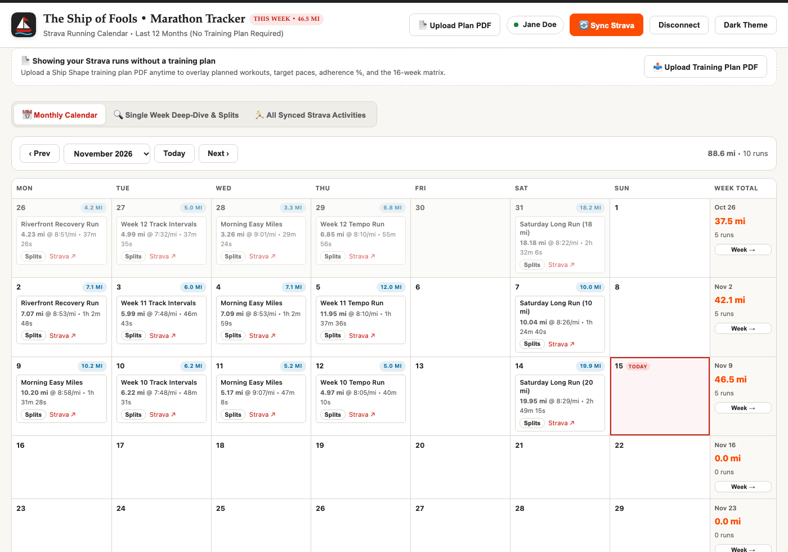
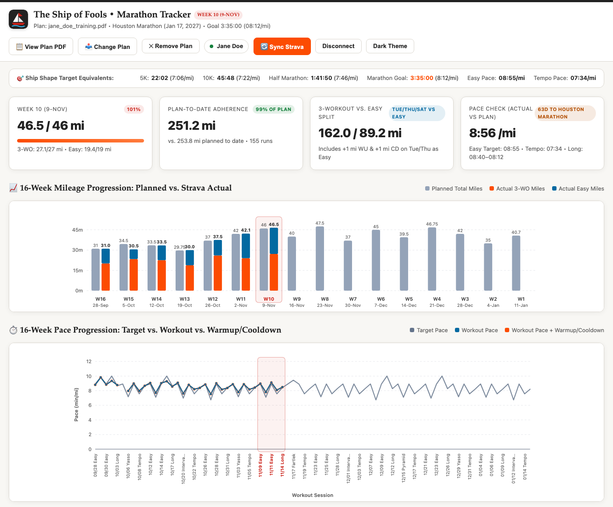
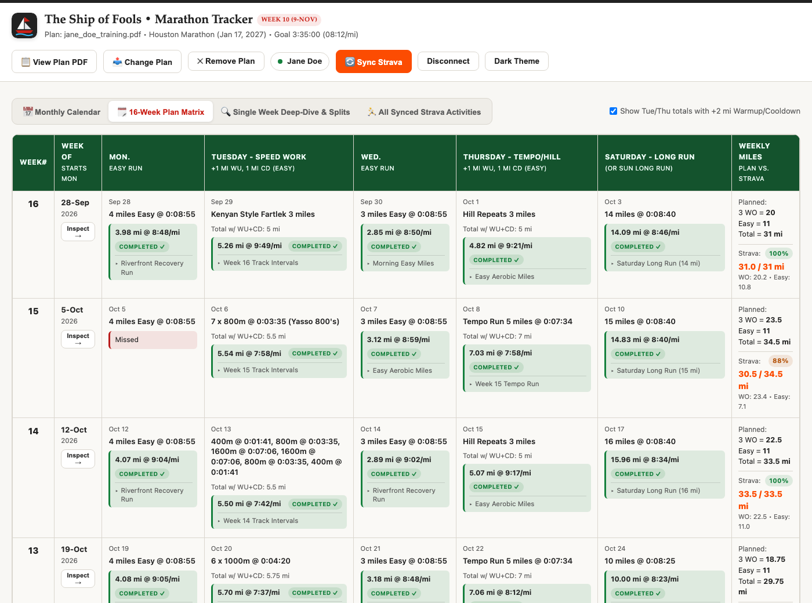
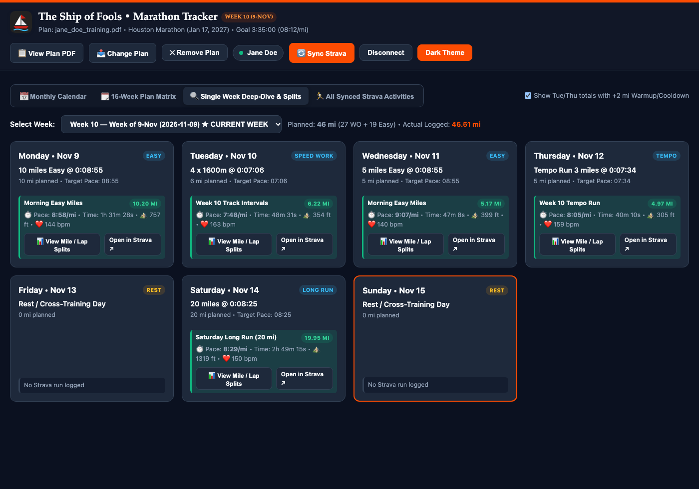

# Ship Shape Running Calendar & Training Plan Tracker

A lightweight Strava running dashboard built for marathoners and everyday runners. Connect your Strava account to explore your last 12 months of runs on an interactive monthly calendar—and optionally upload a 16-week **Ship Shape** training plan PDF anytime to unlock workout targets, pace analysis, adherence stats, and a full 16-week matrix.

---

## Features

### 1. Strava-First Monthly Running Calendar (No Training Plan Required)

Authorize read-only Strava access (`read,activity:read_all`) and immediately start using the dashboard—no training plan upload required:

- Syncs your **rolling 12 months** of Strava running activities.
- Browse runs by month with daily mileage totals, pacing summaries, weekly rollup totals, and direct links to open any run on Strava or view splits.
- Track overall weekly, monthly, and 12-month mileage/pace KPIs before ever adding a schedule.

---

### 2. Optional Training Plan PDF Overlay & Analytics

Upload a Ship Shape 16-week training plan PDF anytime from onboarding or the header bar (**Upload Plan PDF** / **Change Plan**) to layer structured marathon analytics on top of your Strava history:

- **Target Equivalents Banner**: Extracts your 5K, 10K, Half Marathon, Marathon goal time, Easy pace, and Tempo pace from the PDF.
- **Adherence & Split KPIs**: Tracks current-week completion, plan-to-date mileage adherence, **3-Workout (Tue/Thu/Sat) vs. Easy** volume split, average pace checks, and days remaining to goal race day.
- **Mileage & Pace Progression Charts**: Plots planned vs. actual weekly mileage and compares workout paces (with and without `+1 mi` warmup / `+1 mi` cooldown on speed and tempo days) against target pace across all 16 weeks.
- **Inline Plan Viewer**: Open, replace, or remove your uploaded PDF anytime right from the header.

---

### 3. 16-Week Plan Matrix

When a training plan PDF is active, the **16-Week Plan Matrix** tab compares every scheduled Monday–Saturday session against your logged Strava runs:

- Clearly marks completed sessions, missed days, and Sunday long-run swaps.
- Toggles Tuesday/Thursday target totals with or without `+2 mi` warmup/cooldown.
- Displays weekly planned vs. actual completion percentages (`3 WO`, `Easy`, and `Total`) with one-click **Inspect →** drill-down into any week.

---

### 4. Single Week Deep-Dive, Splits & Dark Theme

- **Single Week Deep-Dive & Splits**: Inspect any week day-by-day with heart rate, elevation gain, moving time, and on-demand **View Mile / Lap Splits** fetched from Strava.
- **All Synced Activities Table**: Search and browse your full synced run history.
- **Mobile Friendly & Dark Theme**: Responsive card layout on smaller screens plus a **Dark Theme** toggle in the header.

---

## Running Locally & Customizing

Built with zero third-party runtime dependencies using Python 3.9+ and vanilla HTML/CSS/SVG.

If you want to run the app locally, configure your own Strava API credentials, inspect the HTTP endpoints, or customize the codebase, see **[`DEVELOPMENT.md`](DEVELOPMENT.md)**.

---

## License

Released under the [MIT License](LICENSE).
